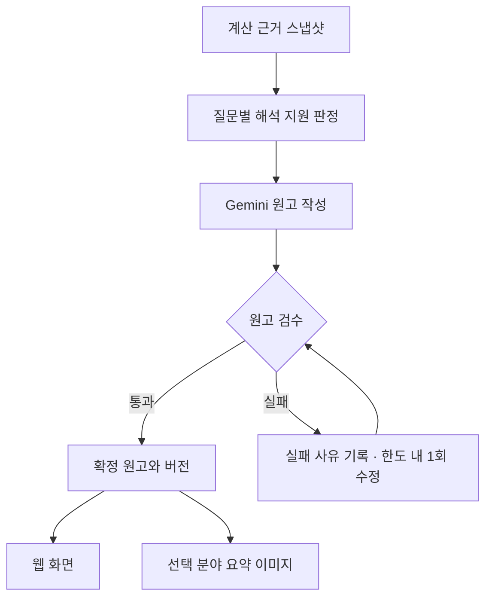

# 별빛의 운명 — 해설 구조 재설계

작성일: 2026-11-04 (한국시간)

상태: 4개 AI 담당의 독립 설계·교차검토·실패 상황 검토를 거쳐 보완한 설계안. 구현, 실제 해설 품질, 계산 정확성, 배포가 검증됐다는 뜻은 아니다. 이 문서만 추가하며 기존 미배포 수정은 보류한다.

## 1. 이번 설계가 해결할 문제

사용자가 선택한 기간·분야에 답하고, 그 이유를 이해할 수 있어야 한다. 짧은 요약과 충분한 본문을 따로 제공하며 화면과 저장 이미지의 의미가 같아야 한다.

확인된 실패 경로:

- 실제 내부 탭은 한글 분야 ID를 만들고, 전용 해설 분기는 영문 ID를 기대한다. (`web/src/SystemReadingViews.tsx`, `web/src/lib/fortuneEditorialV3.ts`)
- 서양·사주·태국 독립 화면 일부는 Gemini 원고 대신 고정 문구를 선택한다. (`web/src/SystemReadingViews.tsx`, `web/src/lib/systemReading.ts`)
- 서버는 일부 원고 항목만 생성하고 누락 항목을 빈 상태로 보충한다. 화면은 모든 분야를 제공하므로 원고 누락과 실제 근거 부족이 섞인다. (`supabase/functions/fortune-interpret-v23-preview/index.ts`)
- 클라이언트가 원고를 다시 숨기거나 자르고, 이미지가 DOM에서 다시 수집·축약한다. (`web/src/PeriodFortuneNarrativeV2.tsx`, `web/src/lib/readingImageExport.ts`)
- 궁합은 길게 생성한 여러 항목을 한 문단으로 합치며, 검수한 일부 사용자용 필드를 실제 화면에서 활용하지 않는다. (`web/src/RelationshipInterpretationPanel.tsx`)
- 일부 검사는 코드 문자열 존재를 확인하고, 의미 반복은 경고로만 처리한다. 실제 사용자 경로와 원고 품질을 별도로 검증해야 한다. (`web/scripts/fortune-quality-audit.mjs`, `web/scripts/relationship-quality-audit.mjs`)

이전 설명의 정정: 사주 일진과 태국 일별 위치 계산은 존재한다. 현재 독립 화면이 월·세운과 연간 배치에 치우쳐 있으며, 계산된 정보가 있다는 것과 특정 질문에 답할 해석 근거가 있다는 것은 다르다.

## 2. 담당별 책임과 금지 경계

| 담당 | 책임 | 하지 않는 일 |
| --- | --- | --- |
| 계산·근거 | 원자료, 적용 기간, 정밀도, 계산 범위, 근거 식별자 | 사용자용 해설 문장 작성 |
| 서버 근거 변환 | 질문별 지원 여부, 허용 주장, 손실 없는 근거 전달 | 점수·십성으로 고정 운세문 생성 |
| Gemini 해설 | 핵심 답, 이유, 생활 장면, 조건, 요약과 상세 | 재계산, 새 점수·미계산 사건 창작 |
| 검수 | 질문 적합성, 근거·기간·조건·중복·완결성 확인 | 불합격 원고를 몰래 고정문으로 대체 |
| 화면·이미지 | 같은 확정 원고의 배치·펼침·페이지 분할 | 문장 재작성, 앞 N문장 요약, 유사도에 따른 몰래 삭제 |

계산 코드와 기존 출처·정밀도 보호장치는 우선 보존한다. 보존은 계산 정확성 인증이 아니다. 새 계산 규칙 추가와 천문·역법 대조는 별도 범위로 관리한다.

## 3. 하나의 원고가 화면과 이미지까지 이어지는 흐름



수정 경로는 최대 1회이며 두 번째 실패 후 순환하지 않는다. 검수기는 실패 코드를 반환하고, 재작성은 Gemini가 담당한다.

### 3.1 요청과 분야 식별

- `product`: fortune / compatibility / reunion / marriage_unmarried / marriage_married. 기존 미혼 결혼궁합·기혼 관계 분석도 별도 계약과 검수 대상으로 포함한다.
- `period`: day / week / month / year, 현지 시작일·종료일, UTC 시작·종료 시각, 시간대. 내부 시간 구간은 시작 포함·종료 제외로 통일한다.
- `system_id`: integrated / western / saju / thai.
- `group_id`: 아래 7개 탭. 한글 표시는 라벨일 뿐 식별자로 사용하지 않는다.
- `entry_id`: 기존 10개 세부 진입 항목. 그룹과 별도 관리한다.
- `topic_ids`: 계산 엔진의 세부 분야를 명시적으로 매핑한다.
- `context`: 사용자가 실제 입력한 생활 역할, 관계 상태, 관찰 기록과 기록 시점. 미입력은 unknown이며 추정하지 않는다.

| 화면 탭 | group_id | 포함 가능한 세부 진입·질문 |
| --- | --- | --- |
| 전체 | overall | 기간 전체의 핵심과 제한 |
| 애정 | love | 관계 교류·속도, 연락·재회 관련 질문은 서로 구분 |
| 대인 | social | 관계·협력, 연락·소식 질문 |
| 학업 | study | study / exam |
| 직업 | work | work / job-change |
| 금전 | money | money / investment |
| 컨디션 | condition | 일정·회복·지속력 |

연락은 애정·대인 양쪽에서 참고할 수 있지만 같은 메시지를 두 분야의 전체 결론으로 쓰지 않는다. 그룹 라우팅과 질문별 근거 연결을 각각 검증한다.

### 3.2 계산 근거 스냅샷

필수 메타: `snapshot_id`, `profile_revision`, `engine_versions`, `rule_versions`, `precision_policy`, `period`, `coverage`, `input_hash`, `calculation_hash`.

각 근거: `evidence_id`, `system_id`, `topic_ids`, `observed_at`, `effective_start`, `effective_end_exclusive`, `resolution`, `direction`, `source`, `coverage`.

전체 계산을 보관한 스냅샷과 모델에 전달할 근거 묶음을 구분한다. 압축 시 `included_ids / omitted_ids / omission_reason / coverage`를 기록하고 누락 구간까지 읽었다고 주장하지 않는다.

### 3.3 질문별 해석 지원 판정

엔진은 계산 사실과 범위를 선언한다. 버전이 있는 서버 변환기가 `system × question × requested_resolution`을 대조해 지원 여부를 확정한다. Gemini와 화면이 이를 추측하지 않는다.

| 체계 | 현재 확인된 자료 | 설명 가능한 범위와 제한 |
| --- | --- | --- |
| 서양 | 일별 근거·시간대 표본·기간 집계 | 선택 기간의 근거 차이를 설명. 표본을 정확한 사건 시각이나 확률로 바꾸지 않음 |
| 사주 | 원국·대운·세운·절기 월운·정오 기준 일진 및 기존 관계 규칙 | 실제 일진과 장기 배경을 구분. 신강약·용희기신·배우자성 등 미지원 항목을 추가 해석하지 않음 |
| 태국 | 출생·연간 타크사, 일별 정오 수리야얏 위치와 기존 위치 자료 | 확인된 배치와 적용 범위를 설명. 원시 위치 변화만으로 일별 길흉·사건 발생을 만들지 않음 |

모든 세부 질문의 지원표가 구현 전에 확정돼야 한다. 위 표는 체계 전체에 대한 포괄적 해석 허가가 아니다. 지원 규칙의 근거가 미확인인 질문은 보류한다.

세 체계 통합은 각 체계의 설명 가능한 관점을 비교한다. 점수 합산, 다수결, 같은 날짜라는 이유로 확신 강화는 금지한다. 결론이 다르면 적용 범위와 이유를 설명한다.

### 3.4 원고 계약

```text
ReadingDocument
  identity: snapshot_id, scope_id, request_key, document_id, revision
  versions: schema, prompt, question_contract, capability_policy
  provenance: provider, model, call_trace_ref, generated_at, verified
  manifest: expected_slots[], completed_slots[], failed_slots[]
  sections[]:
    question_id, group_id, topic_ids, applicable_period
    evidence_status, job_status, quality_status
    claims[]:
      claim_id, statement, evidence_refs[], scope, conditions[]
      required_condition_ids[]
    blocks[]:
      block_id, kind, text, claim_ids[], evidence_refs[], required_with[]
    core_block_ids[], detail_block_ids[], export_block_ids[]
  change: kind, comparison_baseline_id, comparison_rule_version
```

`kind`는 핵심 답·요약·이유·생활 장면·행동·확인점·조건·세부 근거를 구분한다. 해석 주장과 문장은 Gemini가 작성한다. 상태 안내와 용어 정의만 정해진 UI 문구를 허용한다.

`claim_id`는 해당 문서 버전 안에서만 유효하다. 독립 생성물 사이의 동일 ID를 가정하지 않는다. 원고 간 일관성은 질문·근거·기간·범위·주장 방향을 대조한다. 서로 다른 체계의 정당한 차이는 모순 실패로 취급하지 않는다.

요약은 본문에 없는 주장을 추가하지 않는다. 중요한 조건·부정·불확실성이 빠지면 실패다. `required_condition_ids`가 요약·이미지까지 보존되는지 확인한다. 이 목록 자체의 누락도 근거·본문 대조로 검수한다.

상세를 작성하며 핵심이 바뀌면 요약과 상세를 함께 새 버전으로 발행한다. 서로 반대되는 요약·상세를 같은 결과에 두지 않는다.

### 3.5 상태는 서로 다른 축으로 기록

| 축 | 값 | 의미 |
| --- | --- | --- |
| 근거 | supported / partial / insufficient / unsupported / precision_blocked | 답변 범위와 실제 계산 제한 |
| 작업 | not_requested / queued / generating / ready / failed / cancelled | 생성 진행 상황 |
| 검수 | pending / passed / rejected | 원고 검증 결과 |
| 변화 | changed / unchanged / not_comparable | 명시된 비교 기준 대비 근거 변화 |

오류 사유는 `provider_error / missing_slot / validation_error / budget_exhausted` 등으로 별도 기록한다. 모델이 원고를 빠뜨렸다는 이유로 근거 부족 또는 미계산으로 바꾸지 않는다.

`unchanged`는 근거 부족이 아니다. 비교 기준 ID와 의미 비교 규칙이 있을 때만 사용한다. 같은 점수라도 근거가 다르면 다시 검토하며, 근거가 달라졌다고 결론까지 반드시 바뀌어야 하는 것은 아니다.

일부 분야만 실패하면 성공한 완결 섹션과 실패 상태를 한 불변 버전에 명시할 수 있다. 전체 완료 상태로 표시하거나 실패 항목을 숨기지 않는다. 문장 일부만 도착한 초안은 발행하지 않는다. 저장은 선택 범위의 필수 블록이 모두 검수를 통과했을 때만 가능하다.

## 4. 사용자가 실제로 읽을 내용

| 종류 | 핵심 답 | 본문에서 설명할 것 |
| --- | --- | --- |
| 일일 전체 | 선택한 날 가장 두드러지는 점과 우선순위 | 당일 근거, 장기 배경과의 차이, 생활에서 확인할 점 |
| 일일 분야 | 해당 분야의 고유 질문에 대한 답 | 분야 근거, 실제 장면, 행동 또는 추가로 확인할 정보 |
| 주간 | 한 주에 유지되는 점과 달라지는 점 | 근거가 있는 전환 구간, 대응 순서. 변화가 없으면 억지 초·중·후반을 만들지 않음 |
| 월간 | 월의 반복 주제와 경계 | 실제 월중 변화·절기 경계·누적 조건 |
| 연간 | 장기 방향과 중요한 구간 | 실제 자료가 있는 변화와 유지. 분기별 변화를 의무적으로 창작하지 않음 |
| 궁합 | 끌리는 지점, 정서·소통 차이, 반복 충돌, 관계 유지 조건 | 질문별 이유와 생활 장면을 각각 표시. 긴 문단 하나로 합치지 않음 |
| 미혼 결혼궁합 | 함께 생활할 때 맞춰야 할 가치·역할·현실 조건 | 실제 제공된 두 사람 근거 범위에서 설명. 결혼 성립이나 결혼 날짜를 창작하지 않음 |
| 기혼 관계 분석 | 현재 함께 사는 관계의 협력·갈등·회복 조건 | 알려진 실제 상황과 차트 해석을 구분. 미혼의 새 인연·결혼 성립 문구를 재사용하지 않음 |
| 재회 | 현실에서 확인된 단계와 계산상 후보 | 의식·연락·만남·재구축을 구분하고 다음 단계의 확인 조건 제시 |

일일 전체에서 사용자를 학생·직장인·투자자라고 임의로 가정하지 않는다. 학업이라는 단어를 전면 삭제하는 방식이 아니라, 전체 총평과 선택한 학업 질문의 역할을 분리한다. 종합을 위해 무조건 두 분야 이상을 억지 연결하지 않는다.

궁합의 상시 특성, 선택 기간의 변화, 사용자가 알려준 실제 관찰은 서로 다른 섹션이다. 새로운 기간관계 메뉴는 추가하지 않는다. 날짜만 바뀌고 상시 궁합이 같은 것은 정상일 수 있다.

재회 추가 데이터: `observed_state {value, source, as_of}`, `calculated_windows {stage, start, end, evidence_refs}`, `next_stage {required_observations, stop_conditions}`. 연락 정보 없음, 실제 연락 없음, 미래 연락 후보 없음은 서로 다르다. 방향별 활성도만으로 선연락 주체나 상대 속마음을 판정하지 않는다.

## 5. 생성 단위와 비용

1. 최초 통합 결과는 전체와 6개 분야의 **7개 상태·핵심 슬롯**을 한 묶음으로 준비한다. 근거가 허용하는 슬롯만 해설을 작성한다. 미지원·부족·실패도 슬롯으로 명확히 대응한다.
2. 독립 체계는 처음 요청했을 때 해당 체계의 7개 슬롯을 준비한다. 기존에 검수된 정확한 범위의 원고가 있으면 재사용한다. 통합 총평을 독립 체계 원고로 이름만 바꾸지 않는다.
3. 긴 상세는 사용자가 읽기를 요청한 분야만 확장한다. 이미 확정한 핵심 주장과 추가 근거를 함께 전달한다.
4. 모든 4체계×7분야를 자동 선생성하지 않는다. 일반 탭 재방문과 상태 조회는 새 호출을 만들지 않는다.
5. 동일 요청은 한 작업으로 합치고 캐시를 사용한다. 요청한 생성 단위당 기본 1회와 구체 위반 수정 최대 1회. 요청 전체·사용자·검수 묶음별 누적 상한도 적용한다.
6. 호출 전 최대 입력·출력 토큰, 수정분, 가격 변동 여유를 포함한 비용을 예약한다. 실제 API의 출력 제한과 연결하며 한도 초과 시 멈춘다. 현재 단가나 금액을 이 설계에서 임의 확정하지 않는다.

초기 7슬롯 묶음의 시간·출력량·비용은 측정 전이다. 예산 안에 안 들어오면 누락을 정상화하거나 자동 호출을 늘리지 않고 설계 기준을 다시 검토한다. 탭 선택으로 처음 생성되는 경우 생성 중 상태와 비용 제한 상태를 명확히 보여준다.

## 6. 화면·폰트·4:5 저장 이미지

상단은 분야·적용일 → 핵심 제목 → 짧은 요약. 아래는 이유·생활 장면·행동/확인점이며 상세는 펼칠 수 있다. 계산식과 기술 근거는 별도 펼침 영역에 둔다. 필요한 제한은 해당 주장 가까이에 표시하고 긴 공통 주의문으로 핵심을 덮지 않는다.

초기 조판 목표: 제목 약 25–60자, 요약 약 80–180자. 최소 글자수를 채우기 위해 내용을 늘리지 않으며 정확한 문장 수를 강제하지 않는다. 숫자는 설계 목표이고 실제 320·350·393·430px 화면에서 검증 후 확정한다. 가로 넘침·잘림은 실패이며, 과도한 요약 높이도 별도 실패 기준으로 측정한다. 기준은 구현자가 사후에 완화해 통과시키지 않는다.

명조는 해설 제목·요약·본문, 고딕은 버튼·탭·날짜·점수에 적용한다. 기존 밝은 색과 명조 계열을 유지한다. 타이포 토큰과 `ReadingHero / ReadingSection / ReadingState`가 최종 소유하며 체계별 보정 CSS를 계속 덧붙이지 않는다.

기본 저장 범위는 **선택 분야 핵심 요약**이다. 버튼과 파일에 선택 분야·기간을 명시한다. 필수 블록은 핵심 답, 근거 요약, 행동 또는 확인점, 결론을 바꾸는 조건이다. 전체 본문 저장은 후속 기능이며 이번 구조 변경에 끼워 넣지 않는다.

- 이미지도 같은 문서 블록을 사용한다. DOM 재수집·앞 N문장 절단·문구 보충을 제거한다.
- 저장 클릭 시 `snapshot_id + scope_id + revision + schema_version + export_block_ids`를 고정한다.
- 4:5 비율을 유지하고 내용이 넘치면 페이지를 나눈다. 필수 조건을 지우거나 무한히 글씨를 줄이지 않는다.
- 큰 블록은 문단 경계로 나누며, 한 문단이 한 페이지보다 길면 글자를 삭제하지 않고 줄을 이어 배치한다. 이어지는 페이지에는 계속 표시를 둔다.
- 제목만 있는 페이지, 빈 페이지, 이미지 밖으로 넘친 글자는 실패다. 내용이 짧으면 적절한 여백을 허용하고 채우기용 운세문을 만들지 않는다.
- 폰트 로딩 성공 후 측정한다. 실패하면 준비 완료로 표시하거나 조용히 다른 글꼴로 저장하지 않는다.
- 공유 취소는 취소이며 성공이 아니다. 파일 생성·공유 완료·다운로드 시작을 구분하고 실제 기기 저장을 확인하지 못했다면 저장 완료라고 단정하지 않는다.

## 7. 늦은 응답·버전·캐시

응답은 요청 당시 키의 캐시에만 기록한다. 현재 화면의 요청 키와 일치할 때만 표시한다. 발행 직전에도 근거 스냅샷·관찰 기록·계약 버전을 다시 대조한다.

계산 캐시: 계정 격리, 정규화 입력·출생 위치·시간대·정밀도·기간·엔진/규칙 버전. 원고 캐시: 계산 전체 해시·제품·체계·질문 범위·사용자 맥락·관찰 기록·참조일·모델·프롬프트·스키마·지원정책 버전.

정확한 요청 재사용용 해시와 의미상 변화 비교는 분리한다. 일진만 바뀌어도 관련 해설은 재검토하며, 의존하지 않는 체계 결과는 재사용할 수 있다.

저장 중 화면 또는 원고 버전이 바뀌면 해당 저장 작업을 취소한다. 폰트 완료·이미지 변환 완료·공유 직전마다 취소 토큰을 검사한다. 이미 열린 OS 공유창은 통제할 수 없으므로 파일 자체의 날짜·분야·버전은 유지한다.

구형 실제 Gemini 원고도 새 계약에 맞는지 재검증한다. 출처 확인만으로 새 스키마 통과로 간주하지 않는다. 정확히 대응되는 값만 옮기고 누락된 이유·행동을 창작하지 않는다. 호환 불가를 이유로 자동 유료 재생성하지 않는다.

## 8. 합격과 불합격

### 필수 실패 조건

- 애정에 직업 해설 등 질문·분야 불일치.
- 근거 ID가 있지만 실제 주장·날짜·해상도를 뒷받침하지 못함.
- 모델의 생성 누락을 근거 부족으로 처리.
- 핵심 질문에 답하지 않고 범용 조언만 제공.
- 요약·상세가 상충하거나 필수 조건이 이미지에서 누락.
- 장기 배경·원시 위치를 당일 사건으로 승격.
- 계산 후보를 현실의 연락·만남 또는 상대 마음으로 승격.
- 오래된 응답이 현재 날짜·분야에 표시됨.
- 잘림·폰트 실패·저장 0페이지·필수 블록 누락.
- 검수 이견이 해결되지 않았는데 합격 처리.

근거가 같아 문장이 반복되는 것은 자동 실패가 아니다. 반대로 근거가 다른데도 모든 분야에 총평을 복사하거나 단어만 바꾼 일반론을 내놓으면 실패다. 안전한 표현이라는 이유만으로 유용하지 않은 해설을 합격시키지 않는다.

### 검증 자료와 범위

| 단계 | 검증 자료 | 입증하는 범위 |
| --- | --- | --- |
| 구조·상태 | 고정 예시와 오류 사례 | 계약·누락·오류 처리 |
| 실제 진입 | 4체계×7분야 버튼을 실제 선택 | 올바른 원고 또는 정확한 제한 상태 연결 |
| 해설 품질 | 출처 확인된 저장 원고, 필요한 신규 원고 | 질문 적합성·근거·구체성·중복 |
| 모바일 | 320·350·393·430px | 길이·명조·줄바꿈·넘침 |
| 저장 | 실제 생성 PNG와 블록 목록 | 요약 범위·조건·페이지·문구 일치 |
| 배포 | 배포 버전과 실제 사용자 경로 | 검수한 수정이 운영 경로에 반영됨 |

28개 화면 검사는 28개 새 유료 원고를 뜻하지 않는다. 고정 예시와 저장 실제 원고와 신규 생성의 건수를 따로 센다.

대표 표본의 최소 목표는 18개 조건이다: 일일 3(충분/혼합/부족), 주간 2(전환/유지), 월간 2(경계/불충분), 연간 2(변화/표본 제한), 궁합 2(특징이 다른 두 관계), 재회 3(연락 미확인/연락 확인·만남 미확인/후보 없음), 미혼 결혼궁합 2(직접 근거/제한 근거), 기혼 관계 2(관찰 정보 있음/미입력). 같은 원자료 재현과 사람·날짜 변경 비교를 추가한다. 이는 기능 전체 품질 보증 수치가 아니다. 18개는 검수 조건 수이며 18개 신규 유료 호출을 승인하거나 요구한다는 뜻이 아니다.

저장 원고가 새 계약을 충족하지 못하면 구형 호환검사 자료로만 쓴다. 새 호출이 꼭 필요한 경우 실제 비용 한도를 정한 뒤 수행한다. 한도 소진 시 미검증 항목을 남기며 자동 증액하지 않는다.

검수자는 작성자와 분리하고, 독립 AI 판정도 정답으로 간주하지 않는다. 이견이 있으면 근거와 출력으로 재검토한다. 결과표는 모드별 설계/구현/고정예시/저장실원고/신규실원고/화면/이미지/배포를 별도 표시한다.

## 9. 교체 순서와 중단 기준

| 순서 | 산출물 | 다음 단계 진입 조건 |
| --- | --- | --- |
| 1 | 질문별 지원표·ID 매핑·원고/상태 계약 | 어떤 자료로 무엇에 답하는지 확정 |
| 2 | 대표 일일 1건의 근거→원고→모든 분야→이미지 연결 | 동일 문서 버전, 누락·타분야 혼입 없음 |
| 3 | 고정 문구·구형 재요약·DOM 이미지 수집 경로 교체 | 새 경로와 구형 보정이 동시에 실행되지 않음 |
| 4 | 주간·월간·연간의 기간별 해설 연결 | 각 기간 질문과 자료 범위를 별도 통과 |
| 5 | 궁합·미혼 결혼궁합·기혼 관계·재회의 질문별 본문 연결 | 모드별 질문 및 상시/기간/현실 상태 구분, 모든 사용자용 필드의 표시 또는 제외 정책 명시 |
| 6 | 대표 자료·전체 연결·모바일·PNG 검수 | 출시 대상의 필수 미검증·이견 없음 |
| 7 | 제한된 경로에서 배포 확인·복구 가능성 확인 | 운영 경로 버전 확인 후 해당 범위만 완료 보고 |

새 버전 보정 파일을 계속 쌓지 않는다. 기존 진입점 아래 구현을 교체하며 단계별 전환과 복구 경로를 둔다. 복구하더라도 검수 실패 원고를 정상으로 승인하지 않는다. 현재 미배포 패치는 통째로 적용하지 않고 필요한 변경만 새 계약에 맞춰 재평가한다.

## 10. 실제 수행한 3회 검토 기록

| 회차 | 계산·근거 담당 | 해설 생성 담당 | 화면·이미지 담당 | 관계·검수 담당 |
| --- | --- | --- | --- | --- |
| 1차 독립 설계 | 계산 해상도·원고 ID·캐시 계약 | 범위별 선택 생성·원고 필드 | 공통 화면모델·폰트·저장 범위 | 궁합/기간/재회 구분·출시 관문 |
| 2차 교차검토 | 7그룹/10진입 분리, 질문별 지원 권한 | 28칸 개별 생성안을 전체+6분야 묶음으로 변경 | 역순 응답·저장 스냅샷·보정 CSS 제거 | 새 관계 메뉴 제외, 검수 비용 총량·실패 기준 |
| 3차 실패 상황 검토 | 동일점수/다른근거, 일진·시간대·원시위치 | 단일근거·추상문·조건탈락·비용초과 | 버전교체·폰트실패·긴블록·구형데이터 | 관측/후보 혼동, live0, 이견·예산소진 |

3차의 조건부 승인 사항을 본문에 반영했다: 정확한 캐시 해시와 의미 변화 분리, 질문별 지원표, 발행 직전 버전 대조, 필수 조건 결합, 슬롯 누락 검사, 누적 비용 예약, 큰 블록 연속 배치, 구형 원고 재검증, 검증 종류별 완료표.

4차 문서 통합 확인은 계산·근거 담당과 관계·검수 담당이 수행했다. 기존 미혼 결혼궁합·기혼 관계 모드가 질문표와 검수 조건에서 누락된 점을 발견해 제품 목록·질문표·교체 순서에 추가하고 대표 검수 조건을 14개에서 18개로 보완했다.

검토 횟수는 실행 품질의 증명이 아니다. 지원표의 세부 행, 비용·지연 측정, 실제 모바일 조판 상한, 새 계약의 실제 Gemini 출력은 아직 검증해야 한다. 이 항목들을 남긴 채 전체 완료라고 보고하지 않는다.
